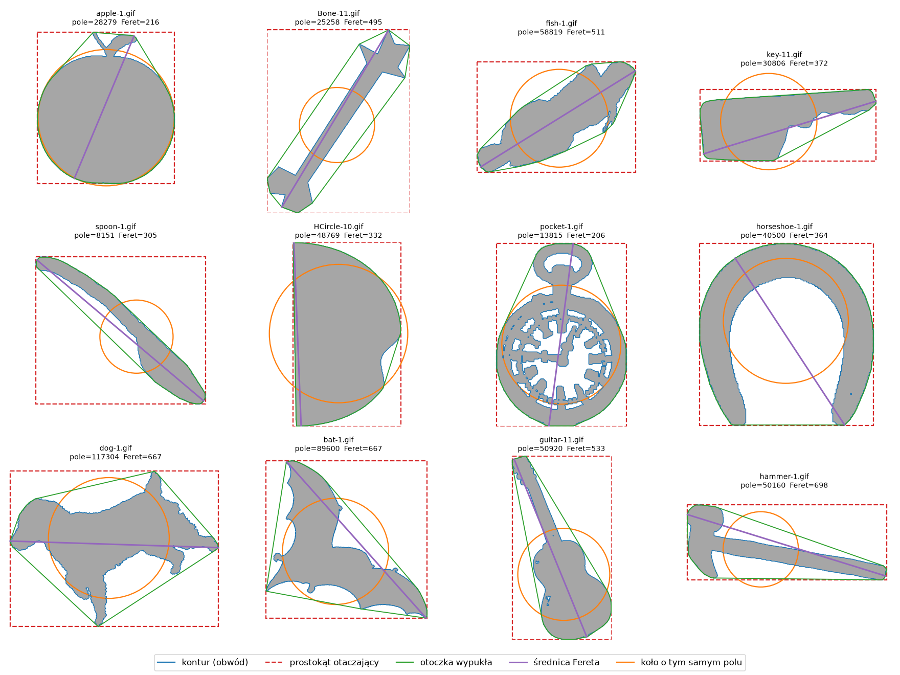
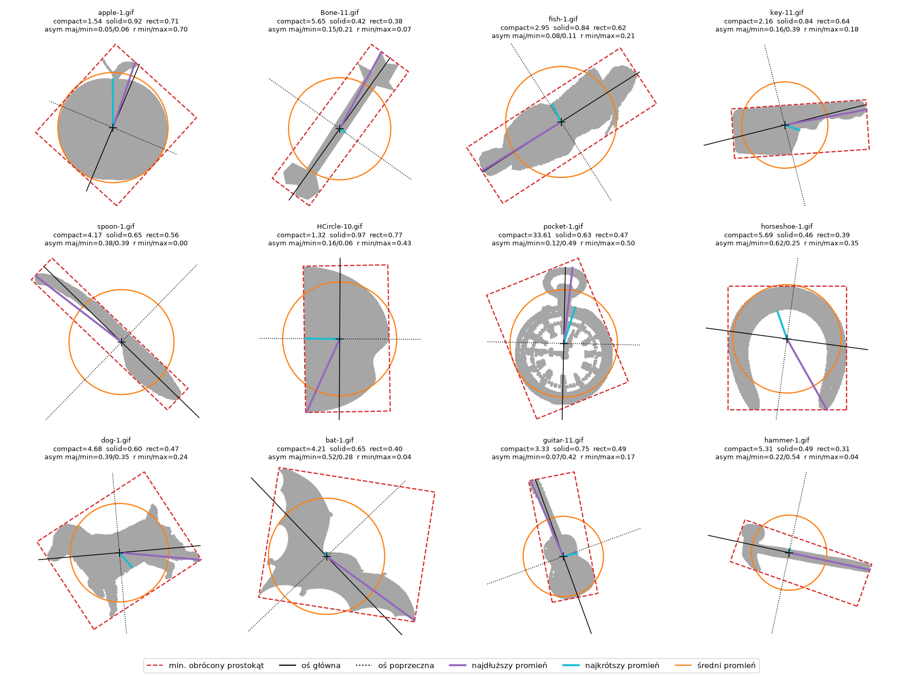
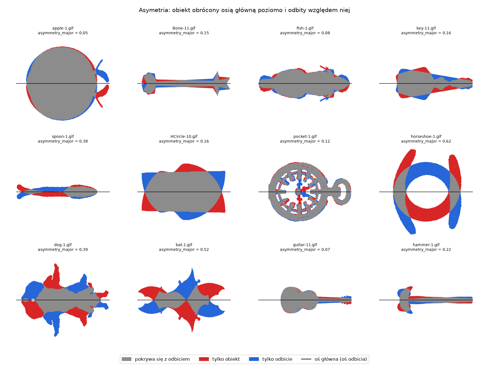
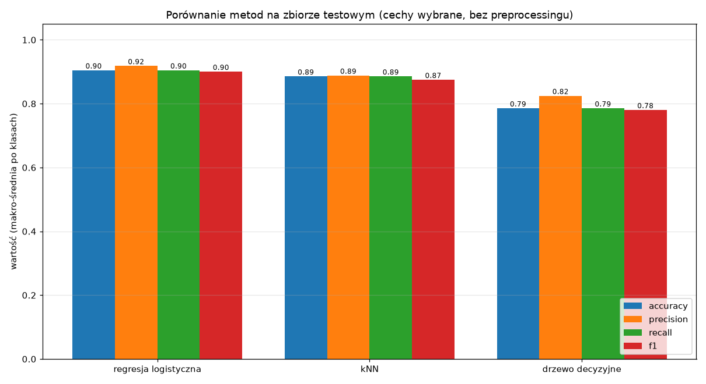
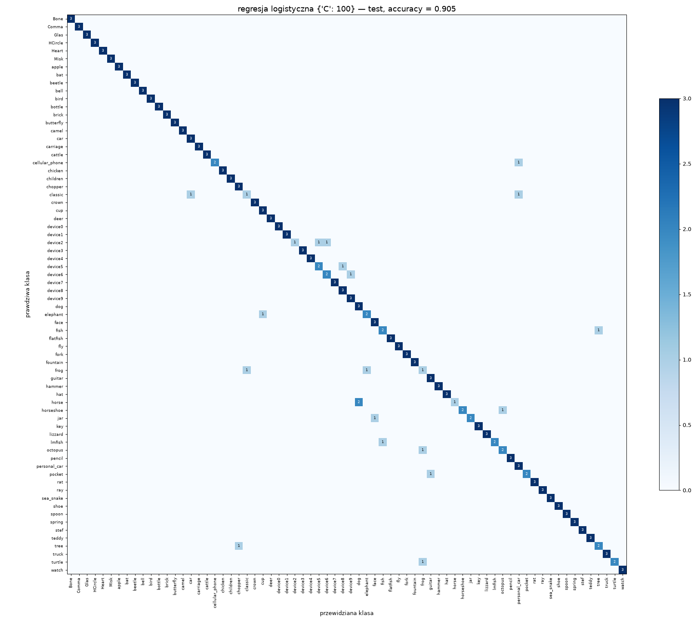
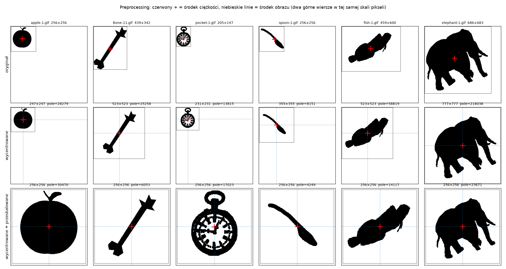
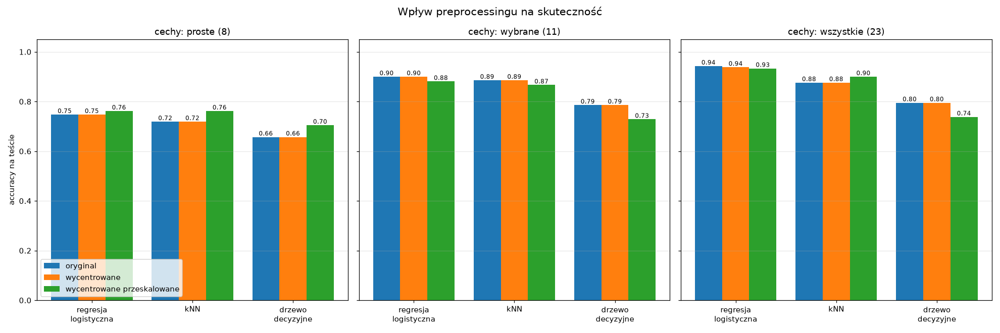

# Ćwiczenie 1 — klasyfikacja obrazów według kształtu

Klasyfikujemy binarne sylwetki obiektów ze zbioru **MPEG-7 CE Shape-1 Part B** na podstawie
ręcznie liczonych cech kształtu i klasycznych algorytmów uczenia maszynowego (bez sieci neuronowych).

Najlepszy wynik: **94,3% accuracy na zbiorze testowym** (regresja logistyczna, wszystkie 23 cechy).

## Uruchomienie

```bash
cd lab01
./split_dataset.sh   # podział na trening / walidację / test (raz)
./start.sh           # cechy -> wykresy -> klasyfikacja (~45 s)
```

Środowisko: Python 3.14, venv zarządzany przez `uv` w `lab01/.venv` (`uv sync` odtwarza go z `uv.lock`).
Biblioteki: scikit-learn, scikit-image, OpenCV, matplotlib.

## Struktura

| Ścieżka | Zawartość |
|---|---|
| `original/` | 1400 obrazów GIF: 70 klas × 20 obrazów, nazwy `<klasa>-<nr>.gif` |
| `split_dataset.sh` | podział na zbiory (punkt 2) |
| `dataset/{1_trening,2_walidacja,3_test}/<klasa>/` | wynik podziału |
| `src/features.py` | wczytywanie masek i obliczanie cech (punkty 3–4) |
| `src/preprocess.py` | centrowanie i normalizacja rozmiaru (punkty 8–9) |
| `src/main.py` | liczy cechy dla każdego wariantu preprocessingu -> `features/<wariant>/features_<zbiór>.csv` |
| `src/visualize.py` | wykresy weryfikujące cechy -> `plots/1–8, 13` |
| `src/classify.py` | normalizacja cech, klasyfikacja, metryki (punkty 5–7, 9) -> `plots/9–12, 14`, `results/` |
| `src/plot_csv.py` | wizualizacja każdego CSV z `features/` i `results/` -> PNG o tej samej nazwie obok pliku |
| `dataset_przetworzone/` | obrazy po preprocessingu (PNG), do podglądu |

### Wizualizacje plików CSV

| CSV | PNG obok pliku |
|---|---|
| `features/<wariant>/features_<zbiór>.csv` | „odciski klas”: średnia każdej cechy w każdej klasie, w odchyleniach standardowych od średniej wszystkich klas |
| `results/podsumowanie.csv` | tabela + słupki metryk dla 3 metod |
| `results/porownanie_preprocessingu.csv` | mapy ciepła accuracy (walidacja, test) i zmiana względem oryginału w p.p. |
| `results/wyniki_per_klasa.csv` | precision / recall / F1 każdej klasy dla 3 metod, najsłabsze klasy na górze |

## 1–2. Zbiór danych i podział

MPEG-7 zawiera 70 klas po 20 sylwetek (biały obiekt na czarnym tle). Obrazy mają **różne rozmiary**
(bok od 38 do 1116 px), a obiekty różną skalę i orientację.

`split_dataset.sh` losuje osobno w każdej klasie **14 obrazów do treningu, 3 do walidacji, 3 do testu**
(980 / 210 / 210). Liczby i ziarno losowania (`SEED=42`, powtarzalny podział) są zmiennymi na początku skryptu.

Walidacja służy do doboru hiperparametrów, test jest używany tylko raz — do końcowej oceny.

### Uwagi o danych

- **OpenCV nie czyta 127 z tych GIF-ów** (`cv2.imread` zwraca `None`), dlatego obrazy wczytujemy przez Pillow.
- **72 obrazy mają kilka rozłącznych fragmentów.** To nie szum, tylko części kształtu (łańcuszek zegarka,
  łaty psa, otwory podkowy) — do 36% powierzchni obiektu. Dlatego cały biały obszar traktujemy jako jeden obiekt.

## 3. Proste cechy

Liczone przez `skimage.measure.regionprops`:

| Cecha | Opis |
|---|---|
| `area` | pole (liczba pikseli) |
| `perimeter` | obwód wszystkich krawędzi (zewnętrznych i dziur) |
| `equivalent_diameter` | średnica koła o tym samym polu |
| `feret_diameter_max` | średnica Fereta — największa odległość między dwoma punktami obiektu |
| `bbox_width`, `bbox_height`, `bbox_area` | prostokąt otaczający (równoległy do osi) |
| `convex_area` | pole otoczki wypukłej |

**Obwód** liczymy z konturu uproszczonego do łamanej (`cv2.approxPolyDP`, tolerancja 1 px).
Standardowe `skimage.measure.perimeter` zawyża obwód o ~8% dla krawędzi pod kątem 30°
(schodki pikseli), co psuło compactness. Nowa metoda ma błąd < 1% przy dowolnym obrocie.



**Wniosek:** wszystkie proste cechy mierzą głównie *rozmiar* obiektu — są ze sobą skorelowane
na poziomie 0,8–0,97, a pierwsza składowa PCA wyjaśnia 82% wariancji.

## 4. Złożone cechy

Większość to ilorazy, więc **nie zależą od skali**:

| Cecha | Wzór / znaczenie |
|---|---|
| `compactness` | obwód² / (4π · pole) — koło = 1, kształty postrzępione >> 1 |
| `solidity` | pole / pole otoczki wypukłej — wypukłość |
| `extent` | pole / pole prostokąta otaczającego |
| `rectangularity` ("kwadratura") | pole / pole najmniejszego *obróconego* prostokąta |
| `aspect_ratio` | krótszy / dłuższy bok obróconego prostokąta |
| `eccentricity` | mimośród elipsy o tych samych momentach drugiego rzędu |
| `asymmetry_major`, `asymmetry_minor` | część obiektu niepokrywająca się z odbiciem względem osi głównej / poprzecznej (0 = symetryczny) |
| `radius_max/min/mean/std` | odległości od środka ciężkości do zewnętrznego konturu (w px) |
| `radius_min_max_ratio`, `radius_mean_max_ratio`, `radius_cv` | te same promienie w postaci bez skali |

Poprawność sprawdziliśmy na figurach syntetycznych (koło, kwadrat, prostokąt 2:1, obrócony prostokąt,
trójkąt) — wartości zgadzają się z teorią.

**Asymetria:** obiekt obracamy tak, by oś główna była pozioma, i odbijamy go względem niej.
Obrót robimy z interpolacją dwuliniową: przy próbkowaniu „najbliższy sąsiad” obiekty z osiami
równoległymi do osi obrazu trafiały w remisy zaokrągleń i odbicie przesuwało się o cały piksel.




Cechy złożone dużo lepiej rozróżniają klasy niż proste. W rankingu statystyki F (ANOVA)
7 z 8 najlepszych cech to cechy złożone (`eccentricity` F = 159, najlepsza prosta F = 42).

Pozostałe wykresy: rozkłady cech w klasach (`plots/4–5`), korelacja (`plots/6`), PCA (`plots/7–8`).

## 5. Wybór i normalizacja cech

Z każdej grupy silnie skorelowanych cech wybraliśmy jedną — **11 cech**: `eccentricity`, `aspect_ratio`,
`rectangularity`, `solidity`, `radius_cv`, `radius_mean_max_ratio`, `radius_min_max_ratio`,
`asymmetry_major`, `asymmetry_minor`, `compactness`, `equivalent_diameter`
(lista `SELECTED_FEATURES` w `classify.py`).

- `compactness` logarytmujemy — ma długi ogon (do ~35 dla zegarka z dziurami).
- Normalizacja **MinMax do [0, 1]**, dopasowana tylko na zbiorze treningowym.

Normalizacja jest kluczowa dla kNN (k = 1, walidacja):

| bez normalizacji | MinMax [0, 1] | standaryzacja |
|---|---|---|
| 45,7% | 81,9% | 83,8% |

Bez niej o odległości decydują cechy w pikselach (setki–tysiące), a ilorazy z zakresu 0–1 są pomijane.

## 6–7. Klasyfikacja i metryki

Trzy metody, hiperparametry dobrane na walidacji (siatka w `METHODS` w `classify.py`):

| Metoda | Parametry | Walidacja | Test accuracy | Precision | Recall | F1 |
|---|---|---|---|---|---|---|
| regresja logistyczna | C = 100 | 83,3% | **90,5%** | 0,918 | 0,905 | 0,900 |
| kNN | k = 1 | 81,9% | 88,6% | 0,888 | 0,886 | 0,875 |
| drzewo decyzyjne | głębokość 15, entropia | 74,8% | 78,6% | 0,825 | 0,786 | 0,780 |

Precision / recall / F1 to średnie makro po 70 klasach. Wyniki dla każdej klasy: `results/raport_<metoda>.txt`
oraz `results/wyniki_per_klasa.csv` (z mapą ciepła `results/wyniki_per_klasa.png`). Najtrudniejsze klasy to
`device5` i `elephant` — regresja trafia 2 z 3, kNN żadnego, drzewo 0 i 1 z 3.




Pomyłki dotyczą podobnych kształtów: koń ↔ pies, ptak ↔ kurczak, wielbłąd ↔ słoń.

**Rozrzut wyników:** test ma tylko 3 obrazy na klasę (210 razem), więc 1 pomyłka to ~0,5 p.p.
Różnice rzędu 1–2 p.p. (np. regresja vs kNN, walidacja vs test) mieszczą się w szumie.
Regresja logistyczna przy dużym C daje też drobne różnice (±1 obraz) w zależności od liczby wątków.

## 8–9. Preprocessing



- **Centrowanie (8):** wycinamy kwadrat, którego środkowy piksel to środek ciężkości obiektu,
  o boku 2 · (najdłuższy promień + 2 px). Obiekt mieści się w całości.
- **Normalizacja rozmiaru (9):** wycentrowany kwadrat skalujemy do 256 × 256, więc każdy obiekt ma
  **praktycznie ten sam najdłuższy promień** (~120–127 px, różnica wynika ze stałego marginesu 2 px). Zmniejszamy z `INTER_AREA`, powiększamy z `INTER_LINEAR`,
  potem progujemy na 0,5.

### Czy to poprawiło skuteczność?

Accuracy na teście (pełna tabela z walidacją: `results/porownanie_preprocessingu.csv`):

| Cechy | Metoda | oryginał | wycentrowane | + przeskalowane |
|---|---|---|---|---|
| proste (8) | regresja logistyczna | 74,8% | 74,8% | **76,2%** |
| | kNN | 71,9% | 71,9% | **76,2%** |
| | drzewo decyzyjne | 65,7% | 65,7% | **70,5%** |
| wybrane (11) | regresja logistyczna | **90,0%** | **90,0%** | 88,1% |
| | kNN | **88,6%** | **88,6%** | 86,7% |
| | drzewo decyzyjne | **78,6%** | **78,6%** | 72,9% |
| wszystkie (23) | regresja logistyczna | **94,3%** | 93,8% | 93,3% |
| | kNN | 87,6% | 87,6% | **90,0%** |
| | drzewo decyzyjne | **79,5%** | **79,5%** | 73,8% |



**Wnioski:**

1. **Centrowanie nic nie zmienia** — i tak powinno być. Wszystkie nasze cechy są liczone względem
   samego obiektu (pole, obwód, promienie od jego środka ciężkości…), więc przesunięcie obrazu
   nie zmienia ich wartości. Centrowanie przyda się dla deskryptorów liczonych względem środka *obrazu*
   (np. momenty Zernike'a w punkcie 10).
2. **Normalizacja rozmiaru pomaga cechom prostym** (+1,4 do +4,8 p.p.). Po przeskalowaniu np. `area`
   oznacza „pole względem najdłuższego promienia”, czyli opisuje kształt, a nie wielkość.
3. **Dla cech złożonych normalizacja rozmiaru nie pomaga, a drzewu szkodzi** (−5 do −6 p.p.).
   Ilorazy i tak nie zależą od skali, a tracimy dwie rzeczy:
   - informację o bezwzględnej wielkości, która w MPEG-7 częściowo niesie informację o klasie
     (obrazy jednej klasy mają często podobną skalę),
   - dokładność: 368 obiektów jest powiększanych (do 4×), a 1032 zmniejszanych (do 5×), co zmienia
     drobne szczegóły konturu, a więc obwód, compactness i promienie.

Podsumowując: preprocessing nie poprawił najlepszego wyniku. Pomaga tylko tam, gdzie cechy zależą od skali.
